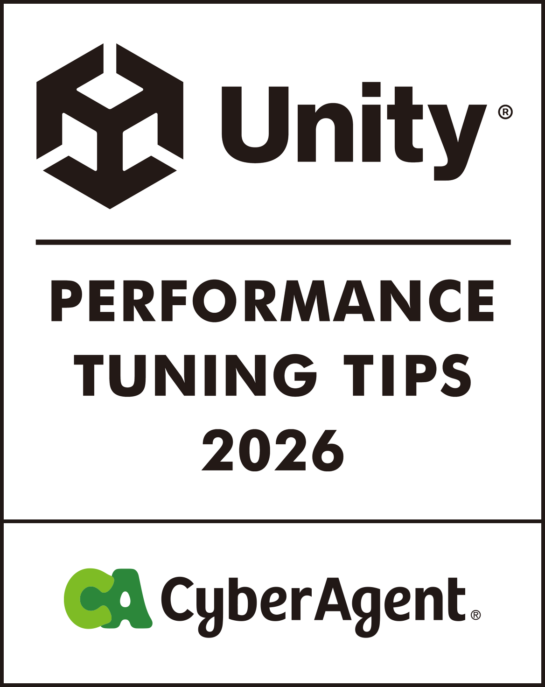

  

# Unity Performance Tips 2026

**Docs** ([日本語](README.md), [English](README_EN.md), [한국어](README_KO.md), [简体中文](README_ZH-HANS.md), [繁體中文](README_ZH-HANT.md))

本書は、2022年に刊行した[『Unityパフォーマンスチューニングバイブル』](https://github.com/CyberAgentGameEntertainment/UnityPerformanceTuningBible)の続編として、Unity 6世代におけるパフォーマンスチューニングの現在地をまとめた書籍です。  
前作の刊行から4年を経て、Unity 6世代の登場からAIによる開発体験の変化まで、幅広い領域で大きな変化が生まれています。本書では社内の有識者が集まり、Render Graph、GraphicsStateCollection、Android向けのLink Time OptimizationなどUnity 6で新しく選べるようになった機能から、開発の現場ですぐに試せる実践的なトピックまで、幅広い主題を実測値とともに取り上げます。  
Web版は [こちら](https://cyberagentgameentertainment.github.io/UnityPerformanceTuningTips2026/ja/index.html) から閲覧できます。  
また、本リポジトリから電子書籍をPDFとしてダウンロードすることができます。

## 電子書籍のダウンロード方法
1. [Releasesの最新版](https://github.com/CyberAgentGameEntertainment/UnityPerformanceTuningTips2026/releases/latest)へ遷移します。

2. AssetsからPDFをダウンロードします。

## 本書について
- スマートフォン向けアプリを前提とした内容です。一部の解説は他プラットフォームに当てはまらない場合があります。
- 検証にはUnity 6系（6000.x）を使用していますが、使用したバージョンは章ごとに異なります。各章に記載したバージョンを参照してください。
- 掲載した数値は、いずれも各章に記載した測定環境での実測値または試算です。環境が変われば値も傾向も変わるため、数値そのものではなく、何がどう効いたのかを読み取ってください。

## 本書の構成
本書は4部21章で構成されています。それぞれの章は独立しているため、必要な箇所のみ読み進めることもできます。巻頭の「課題別の逆引きガイド」には、代表的な症状とそれを扱っている章をまとめています。「序章」では、前作からの数年間でUnityとモバイル環境に何が起きたのかを整理します。

| 部 | 主な内容 |
|---|---|
| 第1部 グラフィックス最適化 | Render Graphによるタイルメモリの節約、UnsafePassの使いどころ、FinalBlitPassの省略、シェーダーの軽量化とウォームアップ |
| 第2部 スクリプティング・アニメーション最適化 | キャラクターアニメーションのチューニング、VATによるボーン負荷の軽減、ParticleSystemのスパイク、非同期処理のライフタイム管理、UIシステムの使い分け |
| 第3部 アセット・設定・ビルド最適化 | AssetBundleのライフタイム管理、アセット肥大化の調査、端末に応じた描画設定の切り替え、Code StrippingとLTO、iOSのメモリ上限 |
| 第4部 計測と自動化 | iOS標準の計測機能、デイリービルドの実機プロファイリングの自動化、本書の知見をAIコーディングエージェントのスキルへ変換する試み |

## ライセンスについて
本リポジトリにはライセンスは適用していませんが、著作権法は適用されます。  
詳しくは以下のページを参照してください。

[Licensing a repository > Choosing the right license](https://docs.github.com/en/repositories/managing-your-repositorys-settings-and-features/customizing-your-repository/licensing-a-repository#choosing-the-right-license)

## 翻訳版について
日本語版を原本として、英語・韓国語・簡体字中国語・繁体字中国語の翻訳版を提供しています。翻訳版はAIによる翻訳をもとに作成しています。表現や内容に差異がある場合は日本語版を正としてください。

| 言語 | Web版 | PDF |
|---|---|---|
| English | [en](https://cyberagentgameentertainment.github.io/UnityPerformanceTuningTips2026/en/index.html) | [book-en-2026.pdf](output/pdf/book-en-2026.pdf) |
| 한국어 | [ko](https://cyberagentgameentertainment.github.io/UnityPerformanceTuningTips2026/ko/index.html) | [book-ko-2026.pdf](output/pdf/book-ko-2026.pdf) |
| 简体中文 | [zh-hans](https://cyberagentgameentertainment.github.io/UnityPerformanceTuningTips2026/zh-hans/index.html) | [book-zh-hans-2026.pdf](output/pdf/book-zh-hans-2026.pdf) |
| 繁體中文 | [zh-hant](https://cyberagentgameentertainment.github.io/UnityPerformanceTuningTips2026/zh-hant/index.html) | [book-zh-hant-2026.pdf](output/pdf/book-zh-hant-2026.pdf) |

翻訳に使う用語集と翻訳メモリは [translation2026](translation2026) にあります。

## Copyright
(C) 2026 CyberAgent, Inc.
