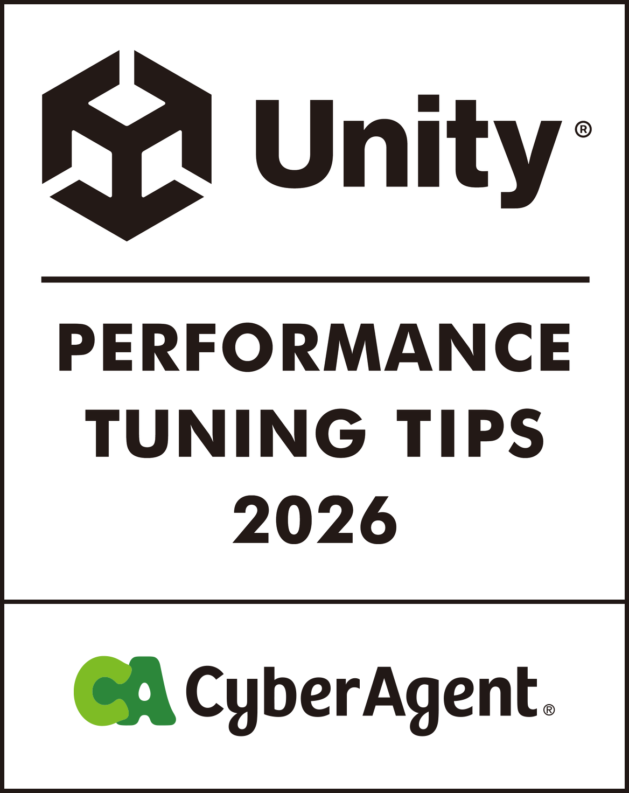

  

# Unity Performance Tuning Tips 2026

**Docs** ([日本語](README.md), [English](README_EN.md), [한국어](README_KO.md), [简体中文](README_ZH-HANS.md), [繁體中文](README_ZH-HANT.md))

This book is the sequel to [*Unity Performance Tuning Bible*](https://github.com/CyberAgentGameEntertainment/UnityPerformanceTuningBible) (2022). It covers where Unity performance tuning stands in the Unity 6 era, from newly available features such as Render Graph, GraphicsStateCollection, and Link Time Optimization for Android to practical topics you can try in production right away, all backed by measured results.  
The web version is available [here](https://cyberagentgameentertainment.github.io/UnityPerformanceTuningTips2026/en/index.html).

## How to download the e-book
1. Go to [the latest release](https://github.com/CyberAgentGameEntertainment/UnityPerformanceTuningTips2026/releases/latest).
2. Download the PDF from Assets.

The English PDF is also available at [output/pdf/book-en-2026.pdf](output/pdf/book-en-2026.pdf).

## About translations
The original edition is in Japanese. The English, Korean, Simplified Chinese, and Traditional Chinese editions are based on AI translation. If a translation differs from the Japanese edition, the Japanese edition takes precedence.

## About License
This repository is not licensed, but copyright laws apply.  
For more information, please refer to the following page for details.

[Licensing a repository > Choosing the right license](https://docs.github.com/en/repositories/managing-your-repositorys-settings-and-features/customizing-your-repository/licensing-a-repository#choosing-the-right-license)

## Copyright
(C) 2026 CyberAgent, Inc.
