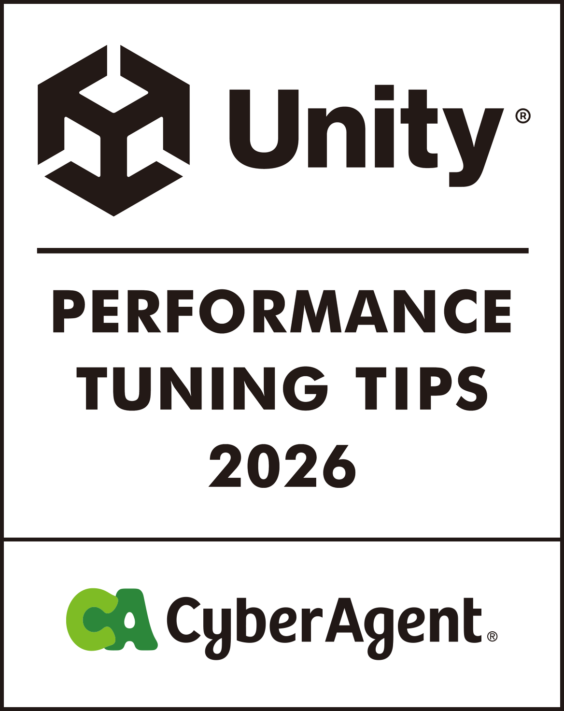

  

# Unity 퍼포먼스 튜닝 팁 2026

**Docs** ([日本語](README.md), [English](README_EN.md), [한국어](README_KO.md), [简体中文](README_ZH-HANS.md), [繁體中文](README_ZH-HANT.md))

이 책은 2022년에 출간한 [『Unity Performance Tuning Bible』](https://github.com/CyberAgentGameEntertainment/UnityPerformanceTuningBible)의 후속작으로, Unity 6 세대 퍼포먼스 튜닝의 현주소를 정리한 책입니다.  
전작 출간 후 4년 동안 Unity 6 세대의 등장부터 AI로 인한 개발 경험의 변화까지, 폭넓은 영역에서 큰 변화가 있었습니다. 이 책에서는 사내 전문가들이 모여 Render Graph, GraphicsStateCollection, Android용 Link Time Optimization 등 Unity 6에서 새로 선택할 수 있게 된 기능부터 개발 현장에서 바로 시도할 수 있는 실전 주제까지, 폭넓은 주제를 실측값과 함께 다룹니다.  
웹 버전은 [여기](https://cyberagentgameentertainment.github.io/UnityPerformanceTuningTips2026/ko/index.html)에서 볼 수 있습니다.  
또한 이 저장소에서 전자책을 PDF로 다운로드할 수 있습니다.

## 전자책 다운로드 방법
1. [Releases 최신 버전](https://github.com/CyberAgentGameEntertainment/UnityPerformanceTuningTips2026/releases/latest)으로 이동합니다.

2. Assets에서 PDF를 다운로드합니다.

한국어 PDF는 [output/pdf/book-ko-2026.pdf](output/pdf/book-ko-2026.pdf)에서도 받을 수 있습니다.

## 이 책에 대해
- 스마트폰용 앱을 전제로 한 내용입니다. 일부 설명은 다른 플랫폼에는 해당하지 않을 수 있습니다.
- 검증에는 Unity 6 계열(6000.x)을 사용했지만, 사용한 버전은 장마다 다릅니다. 각 장에 적힌 버전을 참고하세요.
- 수록한 수치는 모두 각 장에 적힌 측정 환경에서의 실측값 또는 추정치입니다. 환경이 바뀌면 값도 경향도 달라지므로, 수치 자체보다 무엇이 어떻게 효과가 있었는지를 읽어 주세요.

## 이 책의 구성
이 책은 4부 21장으로 구성되어 있습니다. 각 장은 독립적이므로 필요한 부분만 골라 읽을 수도 있습니다. 책머리의 「과제별 역방향 찾기 가이드」에는 대표적인 증상과 그 증상을 다루는 장을 정리했습니다. 「서장」에서는 전작 이후 몇 년 동안 Unity와 모바일 환경에 어떤 일이 있었는지 정리합니다.

| 부 | 주요 내용 |
|---|---|
| 제1부 그래픽스 최적화 | Render Graph를 통한 타일 메모리 절약, UnsafePass의 활용처, FinalBlitPass 생략, 셰이더 경량화와 워밍업 |
| 제2부 스크립팅·애니메이션 최적화 | 캐릭터 애니메이션 튜닝, VAT를 통한 본 부하 경감, ParticleSystem의 스파이크, 비동기 처리의 라이프타임 관리, UI 시스템의 구분 사용 |
| 제3부 에셋·설정·빌드 최적화 | AssetBundle의 라이프타임 관리, 에셋 비대화 조사, 단말에 따른 렌더링 설정 전환, Code Stripping과 LTO, iOS의 메모리 상한 |
| 제4부 계측과 자동화 | iOS 표준 계측 기능, 데일리 빌드 실기기 프로파일링 자동화, 이 책의 지식을 AI 코딩 에이전트의 스킬로 변환하는 시도 |

## 번역판에 대해
일본어판을 원본으로 하여 영어·한국어·중국어 간체·중국어 번체 번역판을 제공합니다. 번역판은 AI 번역을 바탕으로 작성했습니다. 표현이나 내용에 차이가 있는 경우 일본어판을 기준으로 해 주세요.

| 언어 | 웹 버전 | PDF |
|---|---|---|
| 日本語 | [ja](https://cyberagentgameentertainment.github.io/UnityPerformanceTuningTips2026/ja/index.html) | [Releases](https://github.com/CyberAgentGameEntertainment/UnityPerformanceTuningTips2026/releases/latest) |
| English | [en](https://cyberagentgameentertainment.github.io/UnityPerformanceTuningTips2026/en/index.html) | [book-en-2026.pdf](output/pdf/book-en-2026.pdf) |
| 한국어 | [ko](https://cyberagentgameentertainment.github.io/UnityPerformanceTuningTips2026/ko/index.html) | [book-ko-2026.pdf](output/pdf/book-ko-2026.pdf) |
| 简体中文 | [zh-hans](https://cyberagentgameentertainment.github.io/UnityPerformanceTuningTips2026/zh-hans/index.html) | [book-zh-hans-2026.pdf](output/pdf/book-zh-hans-2026.pdf) |
| 繁體中文 | [zh-hant](https://cyberagentgameentertainment.github.io/UnityPerformanceTuningTips2026/zh-hant/index.html) | [book-zh-hant-2026.pdf](output/pdf/book-zh-hant-2026.pdf) |

## 라이선스에 대해
이 저장소에는 라이선스를 적용하지 않았지만, 저작권법은 적용됩니다.  
자세한 내용은 다음 페이지를 참고하세요.

[Licensing a repository > Choosing the right license](https://docs.github.com/en/repositories/managing-your-repositorys-settings-and-features/customizing-your-repository/licensing-a-repository#choosing-the-right-license)

## Copyright
(C) 2026 CyberAgent, Inc.
