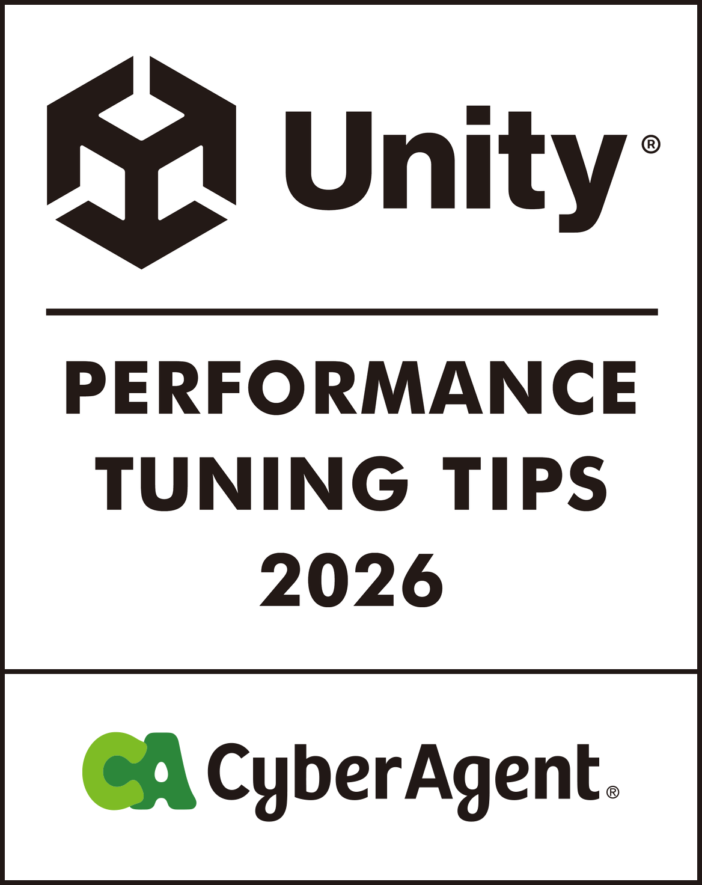

  

# Unity 性能调优技巧 2026

**Docs** ([日本語](README.md), [English](README_EN.md), [한국어](README_KO.md), [简体中文](README_ZH-HANS.md), [繁體中文](README_ZH-HANT.md))

本书是 2022 年出版的[《Unity Performance Tuning Bible》](https://github.com/CyberAgentGameEntertainment/UnityPerformanceTuningBible)的续作，总结了 Unity 6 时代性能调优的现状。  
前作出版后的 4 年间，从 Unity 6 时代的到来到 AI 带来的开发体验变化，许多领域都发生了巨大变化。本书汇集公司内部的专家，从 Render Graph、GraphicsStateCollection、面向 Android 的 Link Time Optimization 等 Unity 6 中新增的可选功能，到可以在开发现场立即尝试的实践性主题，结合实测数据介绍了广泛的内容。  
网页版可在[这里](https://cyberagentgameentertainment.github.io/UnityPerformanceTuningTips2026/zh-hans/index.html)阅读。  
此外，也可以从本仓库下载 PDF 格式的电子书。

## 电子书下载方法
1. 前往 [Releases 的最新版本](https://github.com/CyberAgentGameEntertainment/UnityPerformanceTuningTips2026/releases/latest)。

2. 从 Assets 下载 PDF。

简体中文 PDF 也可以从 [output/pdf/book-zh-hans-2026.pdf](output/pdf/book-zh-hans-2026.pdf) 获取。

## 关于本书
- 本书内容以智能手机应用为前提。部分说明可能不适用于其他平台。
- 验证使用的是 Unity 6 系列（6000.x），但各章使用的版本不同。请参考各章注明的版本。
- 书中的数值均为各章注明的测量环境下的实测值或估算值。环境不同，数值和趋势也会随之变化，因此请关注哪些做法以何种方式产生了效果，而不是数值本身。

## 本书的结构
本书由 4 部分 21 章组成。各章相互独立，也可以只阅读需要的部分。卷首的“按问题分类的反向查询指南”整理了典型症状及对应的章节。“序章”梳理了前作出版后的几年间 Unity 和移动环境发生了哪些变化。

| 部分 | 主要内容 |
|---|---|
| 第 1 部分 图形优化 | 利用 Render Graph 节省 Tile 内存、UnsafePass 的适用场景、省略 FinalBlitPass、Shader 的轻量化与预热 |
| 第 2 部分 脚本与动画优化 | 角色动画调优、利用 VAT 减轻骨骼负载、ParticleSystem 的尖峰、异步处理的生命周期管理、UI 系统的选用 |
| 第 3 部分 资源、设置与构建优化 | AssetBundle 的生命周期管理、资源膨胀的调查、根据设备切换渲染设置、Code Stripping 与 LTO、iOS 的内存上限 |
| 第 4 部分 测量与自动化 | iOS 标准测量功能、每日构建真机性能分析的自动化、将本书知识转换为 AI 编程智能体技能的尝试 |

## 关于翻译版
以日文版为原版，提供英语、韩语、简体中文、繁体中文的翻译版。翻译版基于 AI 翻译制作。如表达或内容存在差异，请以日文版为准。

| 语言 | 网页版 | PDF |
|---|---|---|
| 日本語 | [ja](https://cyberagentgameentertainment.github.io/UnityPerformanceTuningTips2026/ja/index.html) | [Releases](https://github.com/CyberAgentGameEntertainment/UnityPerformanceTuningTips2026/releases/latest) |
| English | [en](https://cyberagentgameentertainment.github.io/UnityPerformanceTuningTips2026/en/index.html) | [book-en-2026.pdf](output/pdf/book-en-2026.pdf) |
| 한국어 | [ko](https://cyberagentgameentertainment.github.io/UnityPerformanceTuningTips2026/ko/index.html) | [book-ko-2026.pdf](output/pdf/book-ko-2026.pdf) |
| 简体中文 | [zh-hans](https://cyberagentgameentertainment.github.io/UnityPerformanceTuningTips2026/zh-hans/index.html) | [book-zh-hans-2026.pdf](output/pdf/book-zh-hans-2026.pdf) |
| 繁體中文 | [zh-hant](https://cyberagentgameentertainment.github.io/UnityPerformanceTuningTips2026/zh-hant/index.html) | [book-zh-hant-2026.pdf](output/pdf/book-zh-hant-2026.pdf) |

## 关于许可证
本仓库未适用任何许可证，但受著作权法保护。  
详情请参考以下页面。

[Licensing a repository > Choosing the right license](https://docs.github.com/en/repositories/managing-your-repositorys-settings-and-features/customizing-your-repository/licensing-a-repository#choosing-the-right-license)

## Copyright
(C) 2026 CyberAgent, Inc.
