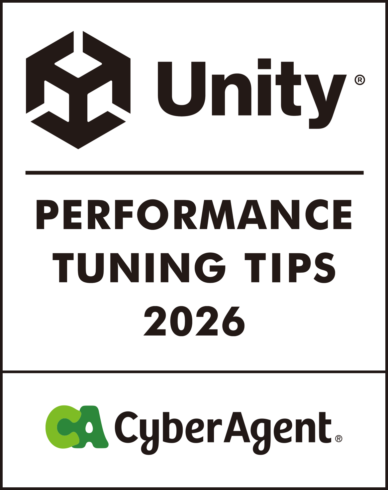

  

# Unity 效能調校技巧 2026

**Docs** ([日本語](README.md), [English](README_EN.md), [한국어](README_KO.md), [简体中文](README_ZH-HANS.md), [繁體中文](README_ZH-HANT.md))

本書是 2022 年出版的[《Unity Performance Tuning Bible》](https://github.com/CyberAgentGameEntertainment/UnityPerformanceTuningBible)的續作，整理了 Unity 6 世代效能調校的現況。  
前作出版後的 4 年間，從 Unity 6 世代的問世到 AI 帶來的開發體驗變化，許多領域都出現了重大變化。本書集結公司內部的專家，從 Render Graph、GraphicsStateCollection、適用於 Android 的 Link Time Optimization 等 Unity 6 新增的可選功能，到能在開發現場立即嘗試的實務主題，搭配實測數據介紹廣泛的內容。  
網頁版可在[這裡](https://cyberagentgameentertainment.github.io/UnityPerformanceTuningTips2026/zh-hant/index.html)閱讀。  
此外，也可以從本儲存庫下載 PDF 格式的電子書。

## 電子書下載方式
1. 前往 [Releases 的最新版本](https://github.com/CyberAgentGameEntertainment/UnityPerformanceTuningTips2026/releases/latest)。

2. 從 Assets 下載 PDF。

繁體中文 PDF 也可以從 [output/pdf/book-zh-hant-2026.pdf](output/pdf/book-zh-hant-2026.pdf) 取得。

## 關於本書
- 本書內容以智慧型手機應用程式為前提。部分說明可能不適用於其他平台。
- 驗證使用的是 Unity 6 系列（6000.x），但各章使用的版本不同。請參考各章註明的版本。
- 書中的數值皆為各章註明的測量環境下的實測值或估算值。環境不同，數值與趨勢也會隨之改變，因此請著重於哪些做法以何種方式產生了效果，而非數值本身。

## 本書的結構
本書由 4 部 21 章組成。各章彼此獨立，也可以只閱讀需要的部分。卷首的「依課題查詢的索引指南」整理了代表性的症狀及對應的章節。「序章」整理了前作出版後的數年間，Unity 與行動環境發生了哪些變化。

| 部 | 主要內容 |
|---|---|
| 第 1 部 圖形最佳化 | 透過 Render Graph 節省 Tile 記憶體、UnsafePass 的使用時機、省略 FinalBlitPass、Shader 的輕量化與預熱 |
| 第 2 部 腳本與動畫最佳化 | 角色動畫調校、透過 VAT 減輕骨骼負載、ParticleSystem 的尖峰、非同步處理的生命週期管理、UI 系統的選用 |
| 第 3 部 資產、設定與建置最佳化 | AssetBundle 的生命週期管理、資產膨脹的調查、依裝置切換繪製設定、Code Stripping 與 LTO、iOS 的記憶體上限 |
| 第 4 部 測量與自動化 | iOS 標準測量功能、每日建置實機效能分析的自動化、將本書知識轉換為 AI 程式設計代理技能的嘗試 |

## 關於翻譯版
以日文版為原本，提供英文、韓文、簡體中文、繁體中文的翻譯版。翻譯版以 AI 翻譯為基礎製作。如表達或內容有所出入，請以日文版為準。

| 語言 | 網頁版 | PDF |
|---|---|---|
| 日本語 | [ja](https://cyberagentgameentertainment.github.io/UnityPerformanceTuningTips2026/ja/index.html) | [Releases](https://github.com/CyberAgentGameEntertainment/UnityPerformanceTuningTips2026/releases/latest) |
| English | [en](https://cyberagentgameentertainment.github.io/UnityPerformanceTuningTips2026/en/index.html) | [book-en-2026.pdf](output/pdf/book-en-2026.pdf) |
| 한국어 | [ko](https://cyberagentgameentertainment.github.io/UnityPerformanceTuningTips2026/ko/index.html) | [book-ko-2026.pdf](output/pdf/book-ko-2026.pdf) |
| 简体中文 | [zh-hans](https://cyberagentgameentertainment.github.io/UnityPerformanceTuningTips2026/zh-hans/index.html) | [book-zh-hans-2026.pdf](output/pdf/book-zh-hans-2026.pdf) |
| 繁體中文 | [zh-hant](https://cyberagentgameentertainment.github.io/UnityPerformanceTuningTips2026/zh-hant/index.html) | [book-zh-hant-2026.pdf](output/pdf/book-zh-hant-2026.pdf) |

## 關於授權
本儲存庫未套用任何授權條款，但受著作權法保護。  
詳情請參考以下頁面。

[Licensing a repository > Choosing the right license](https://docs.github.com/en/repositories/managing-your-repositorys-settings-and-features/customizing-your-repository/licensing-a-repository#choosing-the-right-license)

## Copyright
(C) 2026 CyberAgent, Inc.
